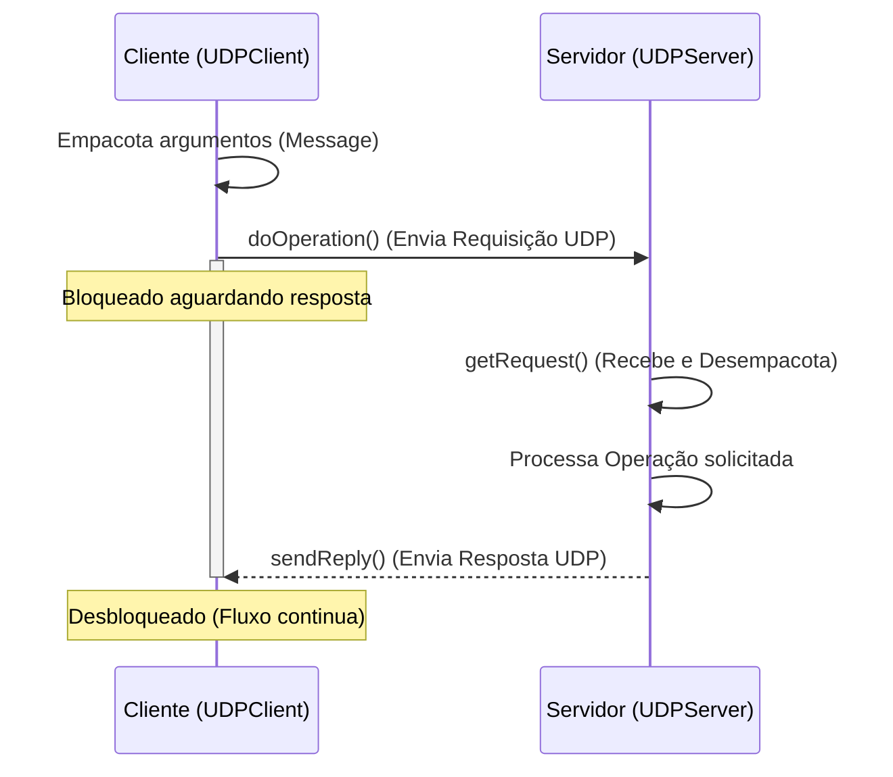

# 📡 Protocolo de Invocação Remota (Middleware RPC sobre UDP)


Este repositório contém a implementação de um protocolo de comunicação de *Middleware* baseado no padrão **Requisição-Resposta** sobre **UDP**. O projeto foi desenvolvido como solução para a atividade prática da disciplina de Sistemas Distribuídos[cite: 27].

O protocolo abstrai a comunicação de rede através de um trio de primitivas (`doOperation`, `getRequest` e `sendReply`)[cite: 16], aproximando-se do funcionamento de um RPC (*Remote Procedure Call*).

## 🏗️ Arquitetura e Fluxo de Comunicação

O diagrama abaixo ilustra a linha do tempo da invocação de um método remoto através do nosso protocolo:



## 📦 Estrutura da Mensagem

Para garantir o transporte via datagramas UDP de forma segura, todas as mensagens (requisições e respostas) são serializadas e empacotadas num único vetor de bytes com a seguinte estrutura de dados:

| Campo | Tipo | Descrição |
| --- | --- | --- |
| `messageType` | `int` | Define a direção: `0` = Request (Requisição), `1` = Reply (Resposta).

 |
| `requestId` | `int` | Identificador único para controlo de sequência da mensagem.

 |
| `remoteReference` | `String` | Referência do objeto ou servidor remoto alvo da execução.

 |
| `operationId` | `int` | Identificador numérico da operação/método a ser executado.

 |
| `arguments` | `byte[]` | Carga útil (*payload*) contendo os parâmetros de entrada ou o resultado processado.

 |

## ⚙️ Primitivas Implementadas

* **`doOperation(host, port, operationId, arguments)`**: Invocada pela aplicação cliente. Empacota a mensagem e bloqueia a *thread* até receber a mensagem de resposta do servidor remoto.


* **`getRequest()`**: Invocada pelo servidor. Abre a porta especificada e bloqueia a execução até à chegada de um novo datagrama de requisição do cliente.


* **`sendReply(reply, clientHost, clientPort)`**: Invocada pelo servidor após processar a operação, devolvendo o resultado em formato de vetor de bytes ao IP e Porta exatos de origem do cliente, desbloqueando-o.


---

## 🚀 Instanciação e Execução

### Pré-requisitos

* **Java Development Kit (JDK)** versão 8 ou superior configurado no *PATH* do sistema.

### 1. Compilar o Projeto

Abra o seu terminal na pasta raiz do repositório (onde estão localizados os ficheiros `.java`) e execute:

```bash
javac *.java

```

### 2. Iniciar o Servidor

Para emular o nó que processará as operações remotas, execute:

```bash
java UDPServer

```

*Saída esperada no terminal:*

> `Servidor iniciado na porta 9090`
> *(O servidor ficará bloqueado à escuta de novas requisições)*

### 3. Executar o Cliente (Teste Local)

Sem fechar o terminal do servidor, abra um **novo terminal** e execute o cliente para testar a invocação:

```bash
java UDPClient

```

*Saída esperada no terminal do Cliente:*

> `Enviando requisição: Ola mundo sistemas distribuidos`
> `Resposta do Servidor: Operação concluída com sucesso: OLA MUNDO SISTEMAS DISTRIBUIDOS`

*Saída esperada no terminal do Servidor:*

> `Requisição recebida ID: 101 | Operação: 1`

---

## 🧪 Testes em Rede (Cliente-Servidor Reais)

Para testar a implementação comunicando com o computador de um colega da disciplina:

1. Garanta que ambos os computadores estão conectados à mesma rede local (Wi-Fi) ou através de uma VPN (como Hamachi ou ZeroTier).
2. Descubra o IP local da máquina que irá atuar como **Servidor** (usando `ipconfig` no Windows ou `ip a` no Linux/Mac).
3. Na máquina do **Cliente**, edite o ficheiro `UDPClient.java` e substitua `"localhost"` pelo IP do servidor:
```java
String host = "192.168.x.x"; // Inserir o IP real do colega

```


4. Guarde o ficheiro e recompile apenas o cliente:
```bash
javac UDPClient.java

```


5. O colega inicia a escuta (`java UDPServer`) e você inicia o envio (`java UDPClient`).

```

<ElicitationsGroup message="Precisa de ajuda com a execução, compilação ou configuração de rede para os testes?">
  <Elicitation label="Testar fora da rede local" query="Como configuro o teste com um colega pela internet, se não estivermos na mesma rede?"/>
  <Elicitation label="Adicionar nova operação" query="Como modifico o código em Java para adicionar uma nova operação com outro operationId?"/>
  <Elicitation label="Lidar com perdas (Timeout)" query="O que acontece se o pacote UDP for perdido na rede? Como melhorar o cliente para tentar novamente?"/>
</ElicitationsGroup>

<FollowUp label="Quer que eu escreva um script automatizado (.bat e .sh) para facilitar a compilação e execução no GitHub?" query="Por favor, crie scripts automatizados para compilar e iniciar o cliente e o servidor facilmente."/>

```